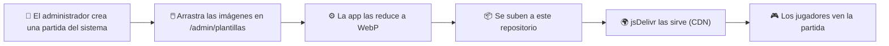

<div align="center">


### 🖼️ El almacén de imágenes de las partidas del sistema

*Aquí viven las fotos que dan vida a las partidas predefinidas de* **[Subasta Salvaje](https://github.com/ElMaxter99/subasta-salvaje)** *🎃 👻 🥤*


</div>

<br>

<table>
<tr>
<td width="38%" align="center">

</td>
<td valign="middle">

## 🎪 ¿Qué es esto?

Subasta Salvaje tiene **partidas del sistema**: partidas ya preparadas por el administrador, como

> 🎃 *Halloween 1* · 🎃 *Halloween 2* · 🏚️ *Casa encantada* · 🥤 *Batido* · …

Cada partida lleva su **portada**, la **imagen inicial de la casa** y las **fotos de sus elementos**. Esas imágenes están **aquí**. Nada más.

</td>
</tr>
</table>

## 🔄 Cómo funciona



- ✍️ **Lo escribe la aplicación.** Los commits los genera la propia app al subir imágenes; no hace falta tocar nada a mano.
- 🔁 **Cambia con el uso.** Su contenido varía según las partidas que el administrador vaya creando, retocando o retirando. No es un archivo estable ni un recurso para reutilizar.
- 🌐 **Es público.** Todo lo que hay aquí puede verlo cualquiera.

## 💚 Sin ánimo de lucro

Subasta Salvaje es un proyecto **gratuito**: sin publicidad, sin ventas y sin cobros de ningún tipo. **No se obtiene dinero con estas imágenes.** Este repositorio existe únicamente para que las partidas de ejemplo se vean bien.

## 📜 Origen y derechos de las imágenes

Las imágenes **pueden proceder de terceros** (buscadores, webs, bancos de imágenes o generadas con IA) y las elige el administrador **para ilustrar partidas dentro del juego**.

| | |
|---|---|
| 🚫 **Derechos** | No se reclama ningún derecho sobre ellas: pertenecen a sus titulares. |
| 📄 **Licencia** | No se concede ninguna licencia ni se garantiza que estén libres de derechos. |
| 🎯 **Uso** | Solo ilustrar las partidas de Subasta Salvaje. **No están pensadas para copiarse ni redistribuirse.** |
| 🔎 **Fuentes** | Cuando se conoce el origen o la licencia de una imagen, se anota en [`FUENTES.md`](FUENTES.md). |

### 🙋 ¿Eres titular de una imagen y quieres que se retire?

Abre un [*issue*](../../issues) indicando la ruta de la imagen y que eres su titular, o escribe a [@ElMaxter99](https://github.com/ElMaxter99) por GitHub. Se retirará de las partidas y del repositorio.

## 🗂️ Cómo están organizadas

```
plantillas/
└── <slug-de-la-partida>/            # p. ej. halloween-1, casa-encantada
    ├── cover-<nombre>-<hash>.webp   # portada de la tarjeta
    ├── scene-<nombre>-<hash>.webp   # imagen inicial de la casa
    └── item-<nombre>-<hash>.webp    # foto de un elemento del catálogo
```

- 🔑 `<hash>`: huella del contenido. La misma imagen no se duplica y un archivo **nunca cambia** una vez subido.
- 🧼 Todas son **WebP** reducidas por la aplicación, sin metadatos EXIF/GPS.

## ✅ Reglas del contenido

- 🙅 **Sin fotos de personas identificables** (ni de menores) ni datos personales.
- 🚯 Sin contenido ilegal, ofensivo o que infrinja derechos de forma evidente.
- 📣 Todo lo que se sube aquí es **público**.

<details>
<summary><b>🛠️ Para quien mantenga la app (configuración)</b></summary>

<br>

La aplicación guarda enlaces **fijados al commit**, que se sirven al instante y no caducan:

```
https://cdn.jsdelivr.net/gh/ElMaxter99/subasta-salvaje-public@<commit>/plantillas/<slug>/<archivo>.webp
```

No uses `@master`: jsDelivr cachea las ramas durante horas.

Variables en Vercel:

```
GITHUB_ASSETS_REPO=ElMaxter99/subasta-salvaje-public
GITHUB_ASSETS_BRANCH=master
GITHUB_ASSETS_TOKEN=…      # token FINO de GitHub, solo para este repositorio, permiso «Contents: Read and write»
```

El token es un secreto: solo en Vercel, **nunca** en este repositorio.

</details>

<br>

<div align="center">

 &nbsp;  &nbsp; 

<sub>Logo y mascota: de <a href="https://github.com/ElMaxter99/subasta-salvaje">Subasta Salvaje</a>, creados con IA para la aplicación.<br>Hecho con 💛 por <a href="https://github.com/ElMaxter99">ElMaxter99</a>.</sub>

</div>
